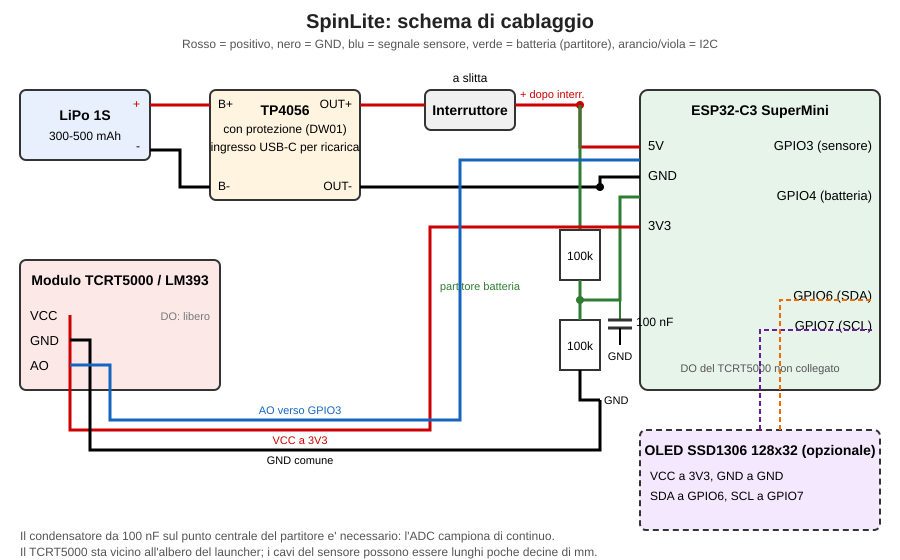

# SpinLite

Conta giri da pochi euro per launcher **Beyblade X**: ESP32-C3 SuperMini + sensore TCRT5000 + piccola LiPo.
I risultati arrivano al telefono via Bluetooth con lo stesso profilo del Bey Battle Pass, quindi funzionano le app esistenti (BeyGear, Spin Meter, Beyblader Helper, 321GoShoot). Display OLED 128x32 opzionale.



**Costo indicativo: circa 8-11 €** (10-13 € con OLED), prezzi AliExpress di ottobre 2026.

## Link

- [Guida completa](docs/guida.md): distinta base, cablaggio, montaggio, taratura, limiti
- [Dashboard web](https://mirkio90.github.io/spinlite/)
- [Web flasher](https://mirkio90.github.io/spinlite/flasher/)
- [Scatolina stampabile](hardware/README.md)

## Limiti da sapere subito

SpinLite misura l'**albero del launcher**, non la trottola. Con i launcher a corda anche il Battle Pass originale sovrastima gli RPM. Dettagli nella guida.

## Stato

| Parte | Stato |
| --- | --- |
| Rilevatore RPM (`rpm_detector.*`) | fatto: 21 casi simulati, errore tipico sotto lo 0,1% |
| Pacchetti Battle Pass (`bbp_protocol.*`) | fatto, verificato con un parser indipendente |
| Schermate OLED (`oled_ui.*`) | disegno testato; driver I2C da provare |
| Firmware ESP32-C3 (`spinlite.ino`: ADC, BLE, console) | scritto completo, **NON ancora provato su hardware** |
| Guida e scatolina | scritte, scatolina non ancora stampata |
| Dashboard web e flasher | vedi i link sopra |

Finché non è provato sul campo, aspettati bug e soglie da tarare.

## Sviluppo

```
make -C test                  # test su PC (rilevatore, protocollo, OLED)
pio run                       # compila il firmware
pio run -e spinlite_oled      # con display OLED
pio run -t upload             # carica sulla scheda
```

Il piano di lavoro e le note tecniche sono in `CLAUDE.md`.

## Licenza

MIT. Progetto non affiliato a Takara Tomy né a Hasbro. Crediti e licenze di terzi (LaunchLab, BRD, MarkChan0225, Migbello) nella guida.
