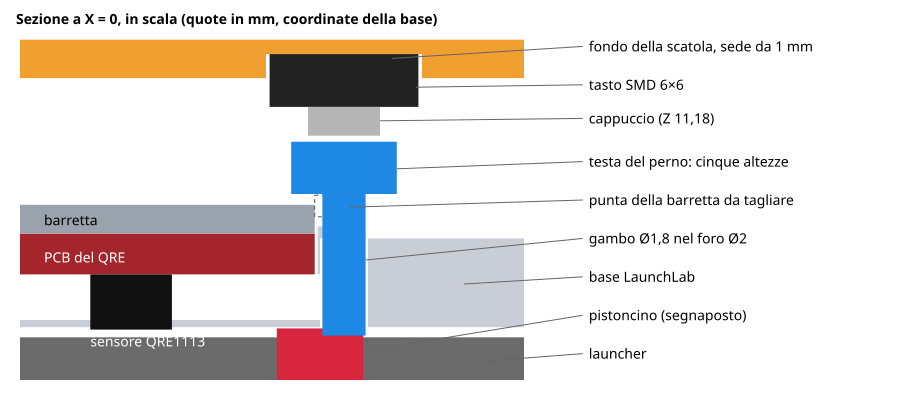

# Presenza della trottola (opzionale)

Il launcher ha un **pistoncino a molla** accanto alla finestrella del sensore: resta sotto il filo quando è vuoto, sale di circa 1 mm con la trottola agganciata e ricade al lancio. Un tasto premuto dal pistoncino dice al firmware se la trottola c'è.

Serve a due cose:

- **scartare gli strappi a vuoto**, che altrimenti finiscono nello storico come lanci;
- **dare alle app il bit vero** "trottola inserita" (0x04 nel pacchetto A0), che senza tasto è solo simulato.

Stato: **firmware testato su PC e supporto meccanico verificato a CAD. Nulla è stato ancora stampato o provato su hardware.**

## Come lo fanno gli altri

| Progetto | Rilevazione | Cosa abbiamo preso |
| --- | --- | --- |
| [OpenRip](https://github.com/moon-lite/OpenRip) (MIT, hardware CERN-OHL-P) | microswitch a leva a bassa forza sul pistoncino; debounce 5 ms | l'idea del pistoncino, le quote, la slitta regolabile per il supporto |
| [Beyblade-Dragoon-RPM](https://github.com/Luciandraw/Beyblade-Dragoon-RPM) (firmware MIT) | tasto verso GND | **armamento "memorizzato"**: il rilascio durante il lancio non annulla la misura |
| [BRD](https://github.com/printfChins/Beyblade-RPM-Detector-Device) (GPL-3.0, solo consultato) | sensore IR "LOAD" su GPIO, debounce 50 ms | due comportamenti: serve un vero fronte libero → premuto per riarmare, e il bit 0x04 del pacchetto A0 segue il contatto |
| [bx-tacho](https://github.com/dazchi/bx-tacho) (GPL-3.0, solo consultato) | secondo fotoriflettore ITR8307 | scartato, vedi sotto |

Dai progetti GPL viene solo il comportamento, nessuna riga di codice.

**Perché un contatto meccanico e non un secondo sensore ottico:** il secondo fotoriflettore non ha parti che toccano il launcher, ma occupa un altro canale ADC nel pattern da cui dipendono i 40.000 campioni al secondo. In bx-tacho la sua luce disturba il sensore dei giri, tanto che il firmware deve accenderne il LED solo in momenti precisi. Il contatto occupa solo un GPIO digitale.

## Come funziona

1. Inserisci la trottola: il contatto si chiude e il dispositivo si **arma**.
2. Tiri: il rilevatore misura come sempre, il percorso a 10 kHz non è stato toccato.
3. La trottola parte e il contatto si apre: durante la misura **non disarma**.
4. Arriva il risultato: viene accettato e l'armamento si consuma.
5. Se tiri senza aver inserito la trottola, in console compare `SCARTATO,<rpm>,trottola non inserita` e il lancio non va nello storico.

Se togli la trottola a mano senza lanciare, il dispositivo si disarma.

Con la presenza attiva il LED fa il lampeggio breve di "pronto" solo da armato, e l'OLED mostra `ATTESA` finché la trottola non è inserita.

## Collegamento e attivazione

| Tasto | SuperMini |
| --- | --- |
| un contatto | GPIO5 |
| l'altro contatto | GND |

Il pull-up è quello interno, non servono resistenze. Poi, da console:

```
presenza on      attiva e salva
presenza         mostra lo stato: contatto premuto/libero, armato si/no
presenza off     torna al funzionamento senza tasto (default)
```

Per provarlo senza launcher: `presenza on`, poi tocca GPIO5 con un filo collegato a GND e controlla con `presenza` che il contatto risulti premuto. Il comando `test` si arma da solo, quindi funziona anche con la presenza attiva.

## Il supporto meccanico

### Dov'è il pistoncino

Coordinate della base LaunchLab (origine al centro delle cerniere, sensore verso -Y). Tre fonti indipendenti concordano:

| Fonte | Dato | Pistoncino risultante |
| --- | --- | --- |
| Modello 3D di Dragoon (`LauncherV2.glb`) | pulsante centrato tra le clip, a **7,6 mm** dal QRE; foro da Ø4,2 nel supporto | (0; ~-0,3) |
| Base LaunchLab, sede del QRE | centro del QRE a (0,14; -7,87) | coerente con i 7,6 mm |
| Base LaunchLab, faccia inferiore | **tasca circolare da circa Ø5, profonda 0,4-0,5 mm**, centrata su (0; 0) | è lo sfogo per il pistoncino |

La tasca è misurata su una griglia da 0,5-1 mm, quindi il centro vale ±0,5 mm. I dati della base vengono dalle parti v098, in coordinate di montaggio; la v102 ha cambiato solo le cerniere.

### Cosa c'è sopra il pistoncino nella base

La base **lo copre**. Salendo da (0; 0):

| Quota Z | Cosa c'è |
| --- | --- |
| 2,7-3,2 | tasca, vuota |
| 3,2-3,5 | velo di plastica da 0,3 mm |
| 3,5-5,4 | vuoto (a Y > 0,5 è tutto pieno fino a 6,9) |
| 5,4-7,1 | fine del PCB del QRE, a Y = -0,22 |
| 5,4-7,4 | blocco della base |
| 7,8-8,7 | barretta premi-sensore, fino a Y = 1,23 |
| 11,2 | piano d'appoggio della scatola |
| 13,4-15,2 | fondo della scatola |

### La soluzione: tasto nella scatola e perno



L'idea viene da Dragoon, che tiene un tasto 6×6 direttamente sopra il pistoncino. Da noi in mezzo c'è la base, quindi un **perno** porta il movimento fino al tasto, che sta nei 4,9 mm liberi tra la base e il fondo della scatola. La geometria è nostra (MIT): da Dragoon, che è CC BY-NC-SA, vengono solo idea e quote.

File in `hardware/enclosure/spinlite_top.scad`:

| `part` | Cosa | Note |
| --- | --- | --- |
| `"box"` | scatola, con la sede del tasto sotto il fondo | `presence = false` la toglie |
| `"pins"` | 5 perni di altezza diversa | testa sul piatto, niente supporti |
| `"jig"` | dima di foratura | si stampa e si butta |

Il perno è a Y = +1 e non sopra il centro del pistoncino, perché a Y = -0,22 finisce il PCB del QRE.

### Montaggio

1. **Fora la base** prima di montare il sensore: avvita la dima ai due rilievi lato +Y con 2 viti M2×6 e fora con una punta **Ø2** fino a uscire nella tasca sotto la base.
2. **Taglia la punta della barretta** a filo del bordo del PCB del QRE, con un tronchesino. Le viti della barretta sono lontane e il sensore resta premuto.
3. Monta il QRE e la barretta come da istruzioni LaunchLab.
4. **Tasto SMD 6×6, altezza 3,4 mm:** salda due fili su due piedini che si collegano **solo a tasto premuto**: trovali col tester, perché i piedini sono collegati a coppie. Mettilo nella sede sotto il fondo con il cappuccio verso il basso, con una goccia di colla.
5. Fai passare i due fili nello spazio sotto il fondo e su dall'apertura dei fili del sensore. Vanno a GPIO5 e GND.
6. Infila il perno nel foro e avvita la scatola: il perno resta chiuso tra base e tasto.

### Scegliere il perno

Le tacche sulla testa dicono quale perno è: una tacca è il più alto, cinque il più basso.

| Tacche | Il pistoncino deve salire di |
| --- | --- |
| 1 | 0,3 mm |
| 2 | 0,5 mm |
| 3 | 0,7 mm |
| 4 | 0,9 mm |
| 5 | 1,1 mm |

Parti dal più basso (5 tacche). Con `presenza` in console controlla il contatto, inserendo e togliendo la trottola, e passa al perno successivo finché **con la trottola inserita il contatto risulta premuto**. Tieni il **più basso che funziona**: il tasto ha solo 0,25 mm di corsa e un perno troppo alto impedirebbe alla trottola di agganciarsi.

### Verifiche e dubbi

Verificato a CAD, con controprova: nessuna collisione di perni, tasto e dima con base, barretta accorciata, PCB, clip e scatola. **Nulla è stato stampato né provato.**

Da controllare sul launcher vero:

1. **Forza:** Dragoon preme un tasto normale direttamente, ma OpenRip raccomanda una leva sotto 0,5 N per non contrastare l'aggancio. Se la trottola si aggancia a fatica, serve un tasto a bassa forza (circa 100 gf).
2. **Quanto sale il pistoncino:** OpenRip dice circa 1 mm, ma la tasca sotto la base è profonda 0,4-0,5 mm. I 5 perni coprono da 0,3 a 1,1 mm.
3. **Diametro del pistoncino:** il perno, decentrato di 1 mm, deve appoggiarci sopra. Dragoon usa un foro da Ø4,2.
4. **PCB del QRE:** se il tuo breakout è più lungo di 14 mm verso +Y, tocca il perno.
5. **Launcher a corda:** OpenRip conferma il pistoncino solo su quello a manovella.
