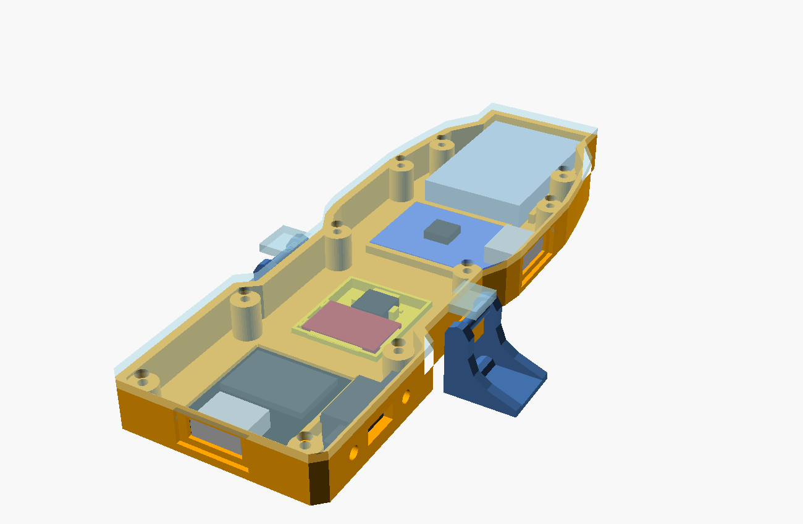

# Scatola piatta (corpo unico sul launcher)

Variante in un pezzo solo, in alternativa alla scatola avvitata sulla base LaunchLab. File: `hardware/enclosure/spinlite_flat.scad`.

**Stato: verificata solo a CAD. Nulla è stato stampato né provato sul launcher.** La distinta di riferimento resta quella con la base LaunchLab finché questa non è stata provata.

## Cosa cambia

| | Scatola su base LaunchLab | Scatola piatta |
| --- | --- | --- |
| Pezzi | base LaunchLab + barretta + scatola + coperchio + perno | corpo + vassoio del sensore + coperchio + 2 clip |
| Tasto di presenza | perno, foro da fare, barretta da tagliare | direttamente sul pistoncino |
| Altezza sul launcher | circa 28 mm | circa 10 mm |
| Lunghezza | circa 70 mm | circa 113 mm |
| Licenze | base CC BY-SA a parte | tutto MIT |

## Da dove vengono le quote

La disposizione segue il progetto [Beyblade-Dragoon-RPM](https://github.com/Luciandraw/Beyblade-Dragoon-RPM) di Luciandraw, un dispositivo costruito davvero. I suoi modelli sono CC BY-NC-SA e non sono nel repo: la geometria è disegnata da zero, e da lì vengono solo idee e posizioni funzionali. Grazie a Luciandraw.

Quote riprese:

- altezza della faccia inferiore e della fascia centrale che entra nell'incavo del launcher;
- posizione del QRE1113 (Y 5,44) e del pistoncino (Y 13,05), e quota del cappuccio del tasto (Z 5,40);
- posizione del perno delle clip e dei loro denti;
- ingombro massimo: il corpo sta dentro la sagoma di Dragoon, così non tocca il launcher più del suo.

Nel suo modello le due clip non sono simmetriche di circa 0,7 mm: ho usato la destra, specchiata. Perno e dente coincidono con quelli delle clip di LaunchLab, un secondo progetto indipendente.

## Disposizione

Da dietro in avanti:

1. **SuperMini**, con la USB-C nella parete posteriore; **interruttore SS12F15** sul fianco +X.
2. **QRE1113 e tasto** nel fondo, con le **clip** ai lati.
3. **TP4056** di traverso, con la USB-C sul fianco +X.
4. **LiPo 502030**.

## Stampa

`part = "plate"` mette tutti i pezzi sul piatto, oppure singolarmente `"body"`, `"lid"`, `"tray"` e `"clips"`. In tutto servono circa 21 g di filamento.

- PETG, layer 0,2 mm.
- Corpo, vassoio e coperchio senza supporti: ognuno appoggia su una faccia piana. Il vassoio è un pezzo a parte proprio per questo: la sua fascia sporge 1 mm sotto il fondo, e se fosse unita al corpo il resto del fondo resterebbe sospeso.
- Le clip si stampano coricate su un braccio, così gli strati seguono il verso in cui lavorano.
- Se la tua stampante è piccola, stampa i pezzi uno alla volta: il corpo è lungo 113 mm.

## Montaggio

1. **QRE1113**, nel vassoio: salda i tre fili direttamente al breakout, senza pettine. Sensore verso il basso nella finestra, PCB sugli appoggi tra le sponde, una goccia di colla a caldo sui bordi.
2. **Tasto SMD 6×6**, nel vassoio: cappuccio nel foro verso il basso, tra le sponde. Salda due fili su due piedini che si collegano solo a tasto premuto (trovali col tester). Una goccia di colla.
3. **Vassoio nel corpo**, da sotto: la fascia resta fuori e appoggia al fondo. Fissalo con qualche goccia di colla lungo il bordo; la spinta del pistoncino lo tiene comunque premuto contro il corpo.
4. **SuperMini**: USB-C nel foro della parete posteriore, scheda sui binari.
5. **Interruttore**: leva nella feritoia, 2 viti M2×6 da fuori e dado dentro.
6. **TP4056** tra le guide, con la USB-C nel foro del fianco. **LiPo** nel vano, su un velo di gommapiuma.
7. Salda i collegamenti come nella [guida](guida.md); il tasto va tra GPIO5 e GND.
8. **Clip**: infila ognuna sul blocco della cerniera, con il dente verso il launcher.
9. **Coperchio** con **10 viti M2×6**. Le sue alette tengono il perno delle clip nella sede.

## Da controllare al primo pezzo stampato

1. **Clip sul launcher.** È il punto più delicato: si devono agganciare e sganciare senza gioco. Sono due parti senza molla, come in Dragoon. Se ballano, si corregge `pivot` o il profilo del dente.
2. **Tasto e pistoncino.** Il cappuccio è alla stessa quota di Dragoon. Con la trottola inserita il contatto deve risultare premuto (`presenza` in console). Se la trottola entra a fatica, serve un tasto a bassa forza (circa 100 gf).
3. **Altezza del cappuccio del tuo tasto:** `tact_h` e `tact_body`. La punta resta alla quota giusta da sola, entro i limiti controllati dagli `assert`.
4. **Breakout QRE:** `qre_pcb` e `qre_h`. Largo 9 mm sta nello spazio con 0,1 mm di margine verso il tasto: se è più largo, un `assert` lo segnala.
5. **Presa:** il corpo è lungo e piatto come quello di Dragoon, ma la comodità va provata in mano.
6. **Interruttore:** passo dei fori e corsa della leva sono stimati, come nell'altra scatola (`sf_pitch`, `sf_travel`).

## Verifiche fatte a CAD

- Corpo, vassoio, coperchio e clip sono ognuno un solido unico.
- Nessuna collisione tra QRE, tasto, SuperMini, TP4056, LiPo, interruttore, corpo, vassoio e coperchio.
- La clip ruota di 15° verso l'esterno senza toccare corpo e coperchio.
- La pianta del corpo sta dentro quella di Dragoon, con al massimo 0,3 mm di sporgenza locale.
